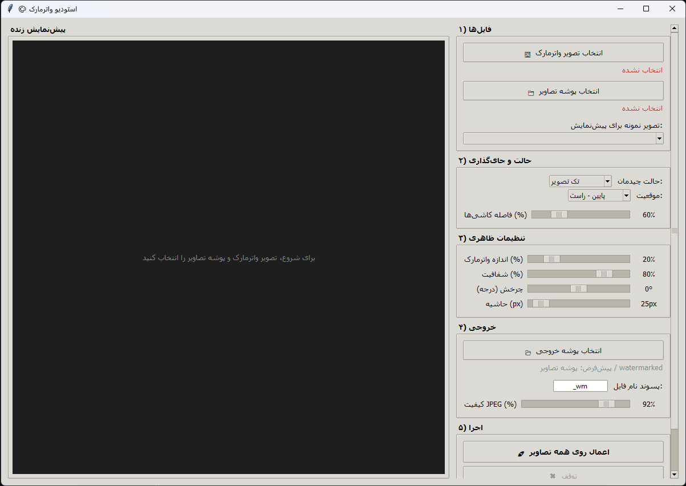

<!-- Improved compatibility of back to top link: See: https://github.com/othneildrew/Best-README-Template/pull/73 -->
<a id="readme-top"></a>
<!--
*** Thanks for checking out the Best-README-Template. If you have a suggestion
*** that would make this better, please fork the repo and create a pull request
*** or simply open an issue with the tag "enhancement".
*** Don't forget to give the project a star!
*** Thanks again! Now go create something AMAZING! :D
-->


<!-- PROJECT SHIELDS -->
<!--
*** I'm using markdown "reference style" links for readability.
*** Reference links are enclosed in brackets [ ] instead of parentheses ( ).
*** See the bottom of this document for the declaration of the reference variables
*** for contributors-url, forks-url, etc. This is an optional, concise syntax you may use.
*** https://www.markdownguide.org/basic-syntax/#reference-style-links
-->
[![Contributors][contributors-shield]][contributors-url]
[![Forks][forks-shield]][forks-url]
[![Stargazers][stars-shield]][stars-url]
[![Issues][issues-shield]][issues-url]
[![project_license][license-shield]][license-url]
[![LinkedIn][linkedin-shield]][linkedin-url]


<!-- PROJECT LOGO -->
<br />
<div align="center">
  <a href="https://github.com/ARGDeveloperShayan/watermark-studio">
    
  </a>

<h3 align="center">Watermark Studio</h3>

  <p align="center">
    A Persian-language desktop studio for applying single or tiled watermarks to entire image folders — with live preview, batch processing, and cancel support.
    <br />
    <a href="https://github.com/ARGDeveloperShayan/watermark-studio"><strong>Explore the docs »</strong></a>
    <br />
    <br />
    <a href="https://github.com/ARGDeveloperShayan/watermark-studio">View Demo</a>
    &middot;
    <a href="https://github.com/ARGDeveloperShayan/watermark-studio/issues/new?labels=bug&template=bug-report---.md">Report Bug</a>
    &middot;
    <a href="https://github.com/ARGDeveloperShayan/watermark-studio/issues/new?labels=enhancement&template=feature-request---.md">Request Feature</a>
  </p>
</div>


<!-- TABLE OF CONTENTS -->
<details>
  <summary>Table of Contents</summary>
  <ol>
    <li>
      <a href="#about-the-project">About The Project</a>
      <ul>
        <li><a href="#built-with">Built With</a></li>
      </ul>
    </li>
    <li>
      <a href="#getting-started">Getting Started</a>
      <ul>
        <li><a href="#prerequisites">Prerequisites</a></li>
        <li><a href="#installation">Installation</a></li>
      </ul>
    </li>
    <li><a href="#usage">Usage</a></li>
    <li><a href="#roadmap">Roadmap</a></li>
    <li><a href="#contributing">Contributing</a></li>
    <li><a href="#license">License</a></li>
    <li><a href="#contact">Contact</a></li>
    <li><a href="#acknowledgments">Acknowledgments</a></li>
  </ol>
</details>


<!-- ABOUT THE PROJECT -->
## About The Project

[![Product Name Screen Shot][product-screenshot]](https://example.com)

Watermark Studio is a single-file Python desktop application for batch-watermarking image folders. It is designed for users who need to apply a logo or watermark consistently across many images without opening a full image editor for each file.

The interface is in Persian and laid out right-to-left. It follows a five-step workflow: choose files, choose placement mode, adjust appearance, choose output, and run. A live preview canvas updates as sliders move, and the batch job runs in a worker thread so the window stays responsive. Processing can be cancelled mid-run, and the status bar reports progress per file.

The app supports `JPG`, `JPEG`, `PNG`, `WEBP`, `BMP`, `TIF`, and `TIFF`. It respects EXIF orientation via `ImageOps.exif_transpose`, uses alpha compositing for transparent watermarks, and saves each output in its original format with format-appropriate settings. JPEG and WEBP use the quality slider; PNG is saved with optimization; TIFF and BMP are handled separately.

<p align="right">(<a href="#readme-top">back to top</a>)</p>


### Built With

* [![Python][Python.py]][Python-url]
* [![Tkinter][Tkinter.py]][Tkinter-url]
* [![Pillow][Pillow.py]][Pillow-url]

<p align="right">(<a href="#readme-top">back to top</a>)</p>


<!-- GETTING STARTED -->
## Getting Started

The application runs locally with Python 3 and Tkinter. It does not require an internet connection, an API key, or a build step.

### Prerequisites

* **Python 3.8 or newer** is recommended.
* **Tkinter** — usually included with the official Python installer. On some Linux distributions, install it separately:
  ```sh
  # Debian / Ubuntu
  sudo apt install python3-tk
  ```
* **Pillow** — required for image loading, compositing, preview, and saving:
  ```sh
  pip install pillow
  ```

### Installation

1. Clone the repository:
   ```sh
   git clone https://github.com/ARGDeveloperShayan/watermark-studio.git
   cd watermark-studio
   ```
2. Install Pillow:
   ```sh
   pip install pillow
   ```
3. Run the application:
   ```sh
   python watermark_app.py
   ```
   Replace `watermark_app.py` with the actual filename of your script.

<p align="right">(<a href="#readme-top">back to top</a>)</p>


<!-- USAGE EXAMPLES -->
## Usage

The UI is organized into five numbered sections.

1. **Files** — choose a watermark image and the folder containing the target images. Select a sample image from the dropdown to preview it.
2. **Mode and placement** — choose `تک تصویر` (single watermark) or `کاشی‌کاری` (tiled watermark). In single mode, choose one of nine positions: top-left, top-center, top-right, middle-left, center, middle-right, bottom-left, bottom-center, or bottom-right. In tile mode, adjust the spacing between tiles.
3. **Appearance** — adjust watermark size as a percentage of image width, opacity, rotation from `-180°` to `180°`, and margin in pixels.
4. **Output** — choose an output folder, set a filename suffix such as `_wm`, and adjust JPEG quality.
5. **Run** — click `🚀 اعمال روی همه تصاویر` to process the folder. Use `✖ توقف` to cancel. The progress bar and status label update per file.

**Behaviour details:**

- If no output folder is selected, the app writes to a `watermarked` subfolder inside the source folder.
- The preview is debounced and redrawn when the canvas is resized or a slider changes.
- Watermark scale is calculated from the target image width, so the same settings behave consistently across different image sizes.
- Tiled mode centers the tile grid and spaces tiles based on a percentage of watermark width.
- Output files keep their original extension and are saved with format-specific settings.
- A result dialog reports how many images succeeded and lists up to eight errors if any files fail.

<p align="right">(<a href="#readme-top">back to top</a>)</p>


<!-- ROADMAP -->
## Roadmap

- [x] Single and tiled watermark modes
- [x] Nine single-watermark positions
- [x] Live preview with debounced redraw
- [x] Batch processing in a worker thread
- [x] Cancel support and per-file progress
- [x] Size, opacity, rotation, margin, spacing, and quality controls
- [x] EXIF orientation handling
- [x] Support for JPG, PNG, WEBP, BMP, TIF, and TIFF
- [ ] Save and load reusable presets
- [ ] Drag-and-drop folder and watermark selection
- [ ] Optional command-line batch mode
- [ ] Per-image position overrides

See the [open issues](https://github.com/ARGDeveloperShayan/watermark-studio/issues) for a full list of proposed features and known issues.

<p align="right">(<a href="#readme-top">back to top</a>)</p>


<!-- CONTRIBUTING -->
## Contributing

Contributions are what make the open source community such an amazing place to learn, inspire, and create. Any contributions you make are **greatly appreciated**.

If you have a suggestion that would make this better, please fork the repo and create a pull request. You can also simply open an issue with the tag "enhancement".
Don't forget to give the project a star! Thanks again!

1. Fork the Project
2. Create your Feature Branch (`git checkout -b feature/AmazingFeature`)
3. Commit your Changes (`git commit -m 'Add some AmazingFeature'`)
4. Push to the Branch (`git push origin feature/AmazingFeature`)
5. Open a Pull Request

<p align="right">(<a href="#readme-top">back to top</a>)</p>

### Top contributors:

<a href="https://github.com/ARGDeveloperShayan/watermark-studio/graphs/contributors">
  
</a>


<!-- LICENSE -->
## License

Distributed under the MIT License. See `LICENSE.txt` for more information.

<p align="right">(<a href="#readme-top">back to top</a>)</p>


<!-- CONTACT -->
## Contact

Your Name - [@your_twitter_handle](https://twitter.com/your_twitter_handle) - your.email@gmail.com

Project Link: [https://github.com/ARGDeveloperShayan/watermark-studio](https://github.com/ARGDeveloperShayan/watermark-studio)

<p align="right">(<a href="#readme-top">back to top</a>)</p>


<!-- ACKNOWLEDGMENTS -->
## Acknowledgments

* [Best-README-Template](https://github.com/othneildrew/Best-README-Template) — README structure and badge conventions
* [Pillow](https://python-pillow.org/) — image loading, compositing, preview, and format-specific saving
* [Tkinter](https://docs.python.org/3/library/tkinter.html) — desktop interface and live preview canvas
* [Shields.io](https://shields.io) — repository badges

<p align="right">(<a href="#readme-top">back to top</a>)</p>


<!-- MARKDOWN LINKS & IMAGES -->
<!-- https://www.markdownguide.org/basic-syntax/#reference-style-links -->
[contributors-shield]: https://img.shields.io/github/contributors/ARGDeveloperShayan/watermark-studio.svg?style=for-the-badge
[contributors-url]: https://github.com/ARGDeveloperShayan/watermark-studio/graphs/contributors
[forks-shield]: https://img.shields.io/github/forks/ARGDeveloperShayan/watermark-studio.svg?style=for-the-badge
[forks-url]: https://github.com/ARGDeveloperShayan/watermark-studio/network/members
[stars-shield]: https://img.shields.io/github/stars/ARGDeveloperShayan/watermark-studio.svg?style=for-the-badge
[stars-url]: https://github.com/ARGDeveloperShayan/watermark-studio/stargazers
[issues-shield]: https://img.shields.io/github/issues/ARGDeveloperShayan/watermark-studio.svg?style=for-the-badge
[issues-url]: https://github.com/ARGDeveloperShayan/watermark-studio/issues
[license-shield]: https://img.shields.io/github/license/ARGDeveloperShayan/watermark-studio.svg?style=for-the-badge
[license-url]: https://github.com/ARGDeveloperShayan/watermark-studio/blob/master/LICENSE.txt
[linkedin-shield]: https://img.shields.io/badge/-LinkedIn-black.svg?style=for-the-badge&logo=linkedin&colorB=555
[linkedin-url]: https://linkedin.com/in/your_linkedin_username
[product-screenshot]: images/screenshot.png
[Python.py]: https://img.shields.io/badge/Python-3776AB?style=for-the-badge&logo=python&logoColor=white
[Python-url]: https://www.python.org/
[Tkinter.py]: https://img.shields.io/badge/Tkinter-FF6F00?style=for-the-badge&logo=python&logoColor=white
[Tkinter-url]: https://docs.python.org/3/library/tkinter.html
[Pillow.py]: https://img.shields.io/badge/Pillow-5A9FD4?style=for-the-badge&logo=python&logoColor=white
[Pillow-url]: https://python-pillow.org/
```

This version keeps the template’s visual structure intact while replacing the QR-code content with accurate Watermark Studio features from your second source file.
